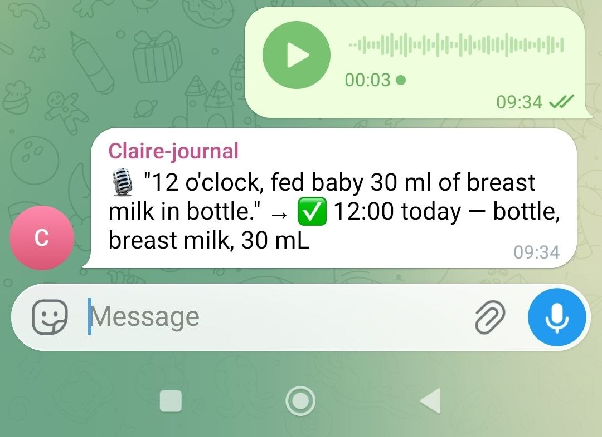
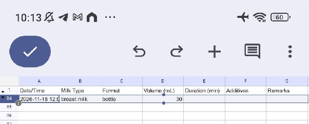
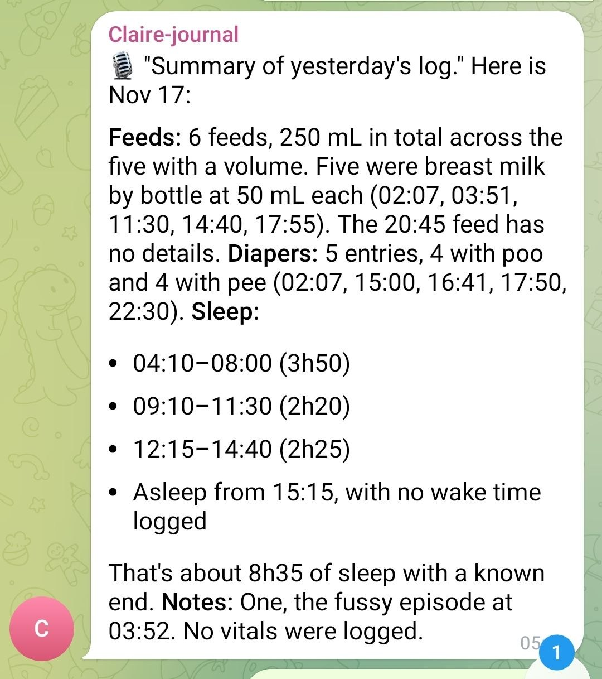

## Data entry to track the health of a newborn

My partner and I recently welcomed our first newborn, Claire, into the world. As first-time parents, we are still learning the ropes. As in corporate life, measuring success matters: it helps make sure she is growing healthily, and it helps with troubleshooting when something seems off. The metrics to track are her feeding and her poo/pee behaviour. Straight from the labour room to the ward, the midwife introduced us to a simple table to journal these events.

| Date | Time | Feed | Poo | Pee |
|---|---|---|---|---|
| 8 Nov | 09:00 | 1 |  |  |
| 8 Nov | 10:15 | 1 |  | 1 |

At face value, the task is not cumbersome. In reality, it piles on top of a crying baby, confusion, sleep debt and more.

But what if I had a personal agent to write these down?

---

## A Nanoclaw data-entry/journaling agent

One might say: just use Claude/ChatGPT/Gemini chat out of the box. I agree it would work, but their built-in memory is not observable, and connecting them to Google Workspace (just to read/write a single sheet) arguably grants the chat session far too much access.

What I really need is an agent to tabulate my unstructured logs.

To achieve this, I need:

1. **A way to talk to the AI agent.** [Nanoclaw](https://github.com/qwibitai/nanoclaw) wires common messaging apps, such as Telegram, to a hosted AI model.
2. **A logging table.** For simplicity, a Google Sheet.
3. **A tool for the agent to write into the table.** An Apps Script attached to the Sheet, which the agent calls over HTTPS to read/write.

```
 Me / partner ⇄ Telegram group ⇄ Nanoclaw (Raspberry Pi) ──▶ "babylog" agent
   (voice or text)                 │                               │
                                   └─ voice → transcription        │ HTTPS POST
                                                                   ▼
                                       OneCLI gateway (injects API key)
                                                                   │
                                                                   ▼
                                       Apps Script web app (/exec)
                                                                   │
                                                                   ▼
                     Google Sheet: journal-log (raw message, always)
                        └─ parsed into → feed-log · poopee-log · sleep-log · vitals-log · notes-log
```

---

## Setup

I host Nanoclaw on my **Raspberry Pi 4 Model B (4GB)**, a low-cost setup that runs 24/7. To talk to the agent, I chose **Telegram**: it is easy to set up a bot, I can add it to a group chat with my partner, and Nanoclaw supports it as a channel out of the box.

Data is logged in **Google Sheets**, which is plenty for this task. To let the agent read/write the Sheet, I use **Apps Script** to host an API endpoint that runs custom functions against that one Sheet. Compared with wiring the agent into Google Workspace wholesale, this limits its access to a single Sheet and restricts its interactions to a pre-defined set of actions.

---

## Vibe-coding

Apart from setting up Nanoclaw and wiring it to Telegram, the entire project was vibe-coded from a written specification.

### Apps Script

The Apps Script API endpoint (`Code.gs`) exposes the following actions, which let the agent log events and recall logged data so that users can "talk to" their data. Every call is a JSON `POST` to the web app's `/exec` URL.

| Action | What it does |
|---|---|
| `meta` | Returns the sheet's title, timezone, tabs and row counts |
| `append` | Appends rows to one tab |
| `log` | Writes to several tabs in one locked call (e.g. the raw `journal-log` row plus its parsed rows) |
| `tail` | Returns the last *n* rows of a tab |
| `query` | Returns rows whose Date/Time falls within a range |
| `update` | Edits a row, e.g. "actually it was 120ml" |
| `void` | Marks a row as VOID, used for "undo last" |
| `summary` | Totals for a given day |

Each message is kept verbatim in `journal-log`, then parsed into structured tabs:

| Tab | Columns |
|---|---|
| `feed-log` | Date/Time, Milk type, Format, Volume (mL), Duration (min), Additives, Remarks |
| `poopee-log` | Date/Time, Poo, Pee, Remarks |
| `sleep-log` | Date/Time, Status, Remarks |
| `vitals-log` | Date/Time, Feature, Measurement, Unit, Remarks |
| `notes-log` | Date/Time, Notes |

### Agent setup

To initialise the agent on the Raspberry Pi, I had Claude Code follow the `SETUP.md` context file. This step assumes the agent is already wired to a Telegram channel and that the Google Sheet and Apps Script are in place. All you need to supply is the generated API key (stored in OneCLI, whose gateway injects it into the agent's requests, so the key never enters the agent's container or context) and the deployed Apps Script endpoint URL.

Voice notes are also a convenient way to message the agent. They require an extra transcription step, which Nanoclaw does not provide. Instead, I route voice notes to OpenAI's gpt-transcribe model and pass the transcript on to the agent.

---

## Example

### Logging a new feed

I send a voice note about a feed. The agent repeats the transcribed note, so I can check it was heard correctly, along with the logging action it took.



The resulting row in the Sheet, recording the feed:



### Recall to summarise

The recall actions defined in the Apps Script let the agent read the Sheet's contents and return useful summaries or insights. For example, my voice note "Summary of yesterday's log" returned the following:



(Admittedly, "asleep since 15:15" with no wake time is not realistic. That gap is on me for not logging it, not the agent making things up.)

---

## Sharing

You can find everything in my GitHub repository, which contains the Apps Script code and the context files: [code4plot/baby-journal](https://github.com/code4plot/baby-journal).

| File | Purpose |
|---|---|
| `README.md` | Overview, quick start and security notes |
| `docs/SETUP.md` | Full step-by-step setup guide (the context file Claude Code follows), with the API reference and troubleshooting |
| `apps-script/Code.gs` | The JSON API: `log`, `append`, `tail`, `query`, `update`, `void`, `summary`, `meta` |
| `apps-script/appsscript.json` | Apps Script manifest (V8 runtime, web app settings) |
| `nanoclaw/babylog/instructions.prepend.md` | The journaling agent's standing instructions |
| `nanoclaw/babylog/tools/baby_api.py` | API client the agent calls (Python standard library only) |
| `nanoclaw/babylog/tools/baby_api.example.json` | Template for the exec URL and sheet URL (the key lives in OneCLI) |
| `nanoclaw/main-agent/instructions.baby-mode.md` | Alternative: add baby-logging to your main agent, triggered by a `baby` prefix |

*This is a logging tool, not medical software. Always consult your baby's doctor about health concerns.*
